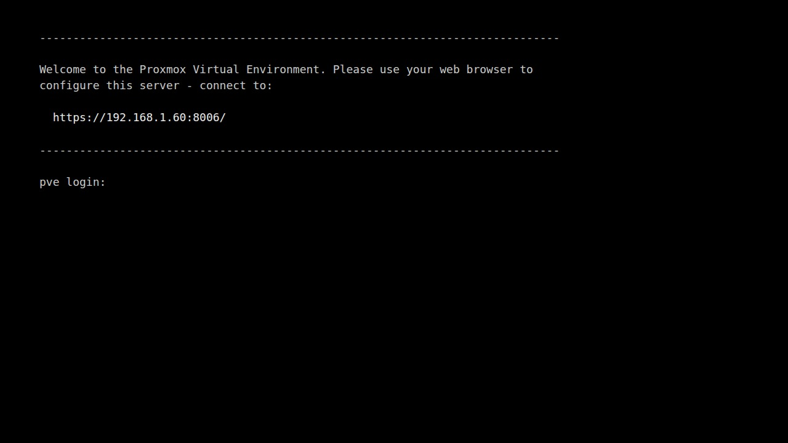
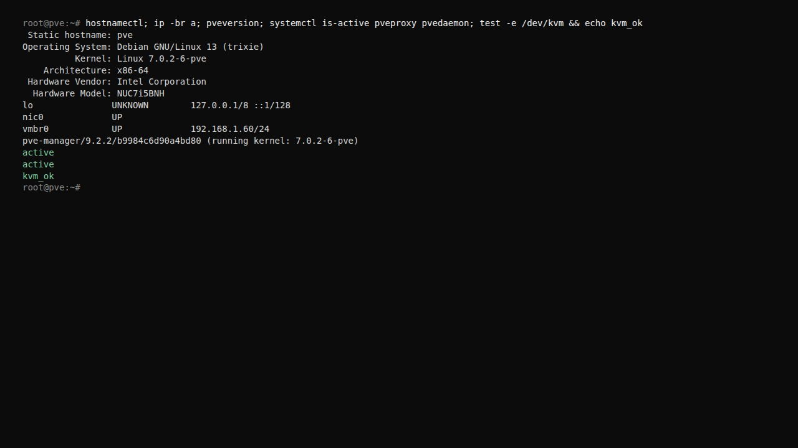
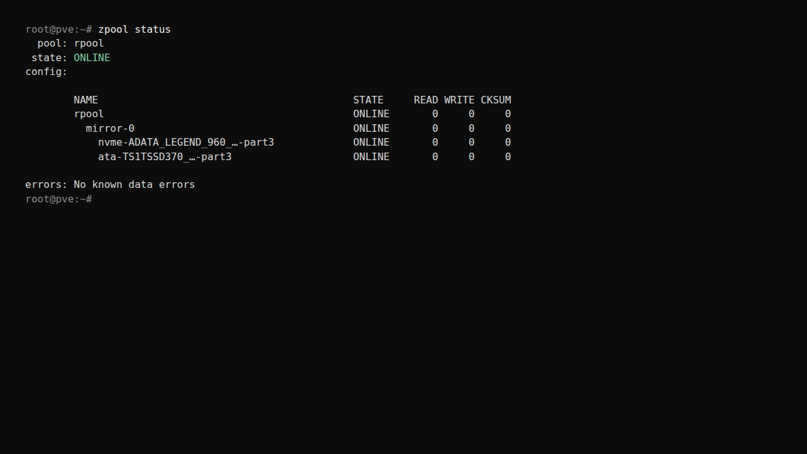

# First boot

The console prints the management URL. Note it.



Log in as `root` with the install password. Your IP will differ; this guide's
examples use `192.168.1.60`.

## Check the host

<div class="run" markdown>

```bash
hostnamectl; ip -br a; pveversion
systemctl is-active pveproxy pvedaemon
test -e /dev/kvm && echo kvm_ok
```

```text {.no-copy}
 Static hostname: pve
…
vmbr0            UP             192.168.1.60/24
pve-manager/9.2.26/… (running kernel: …)
active
active
kvm_ok
```

</div>



You want `vmbr0` with your IP, two `active`, and `kvm_ok`. No `kvm_ok` means
VT-x / AMD-V is off in firmware.

## Check storage

=== "Two disks: ZFS mirror"

    Run `zpool status`. Both legs of `mirror-0` should be `ONLINE`.
    `DEGRADED` means a disk is missing or failing — reseat or replace it.

    

=== "One disk: ext4"

    Run `lsblk -o NAME,SIZE,FSTYPE,MOUNTPOINT` and `pvs`. You should see the
    `pve` volume group on the install disk.

## Next

[Update host](update-host.md)
