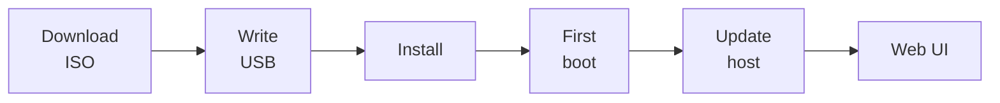

# Overview

Install **Proxmox VE** on spare x86_64 hardware and open the web UI on your
LAN.

| Step | Page | You end with |
| --- | --- | --- |
| 1 | [Download ISO](download.md) | Verified `proxmox-ve_9.2-1.iso` |
| 2 | [Write USB](write-usb.md) | Bootable stick |
| 3 | [Install](install.md) | Proxmox VE on the target disk(s) |
| 4 | [First boot](first-boot.md) | Management URL and healthy services |
| 5 | [Update host](update-host.md) | Current packages, correct apt repos |
| 6 | [Prove web UI](prove-web-ui.md) | Logged in at `https://<ip>:8006` |

!!! info "Out of scope"
    Clustering, HA, Ceph, and guests (VMs, containers). Those belong in the
    walkthroughs that link here. No subscription is required.

[What you need](prerequisites.md){ .md-button }
