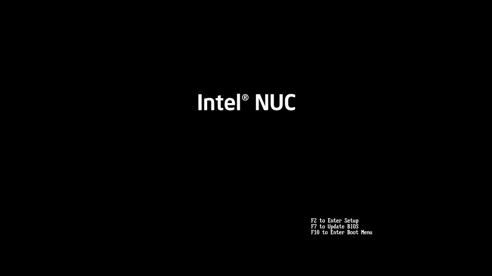
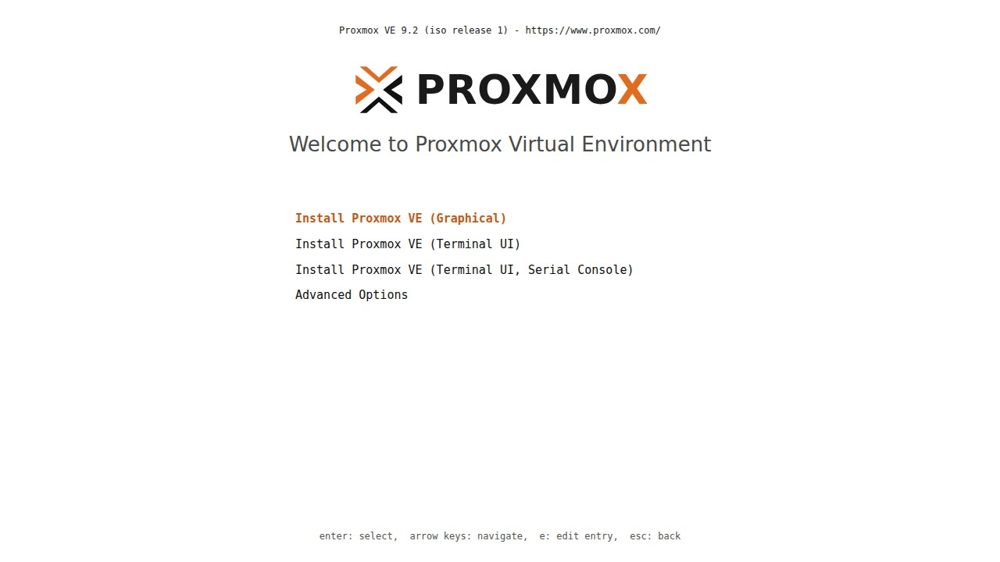
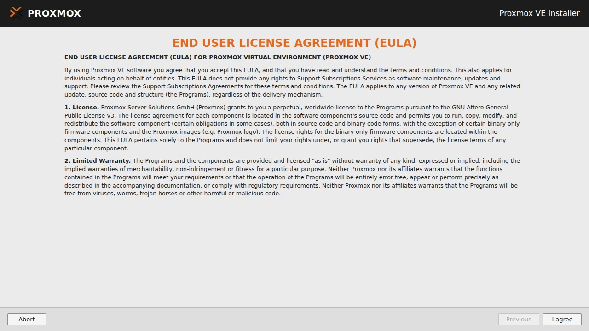
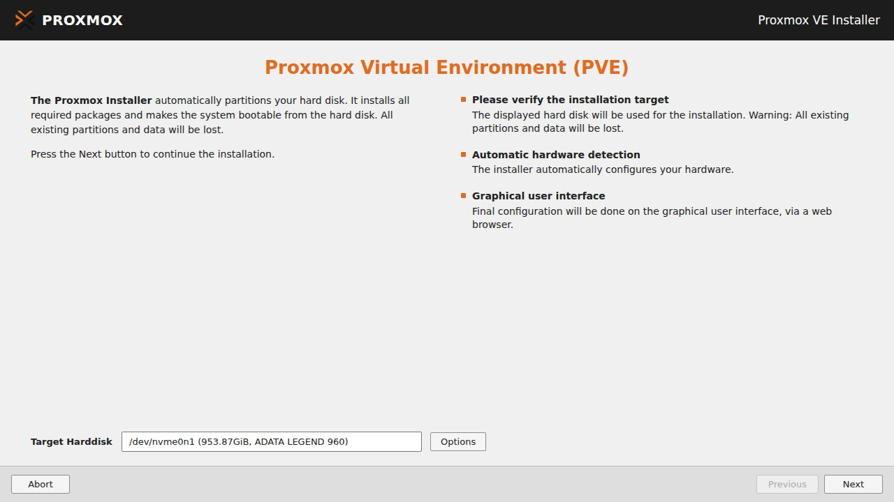
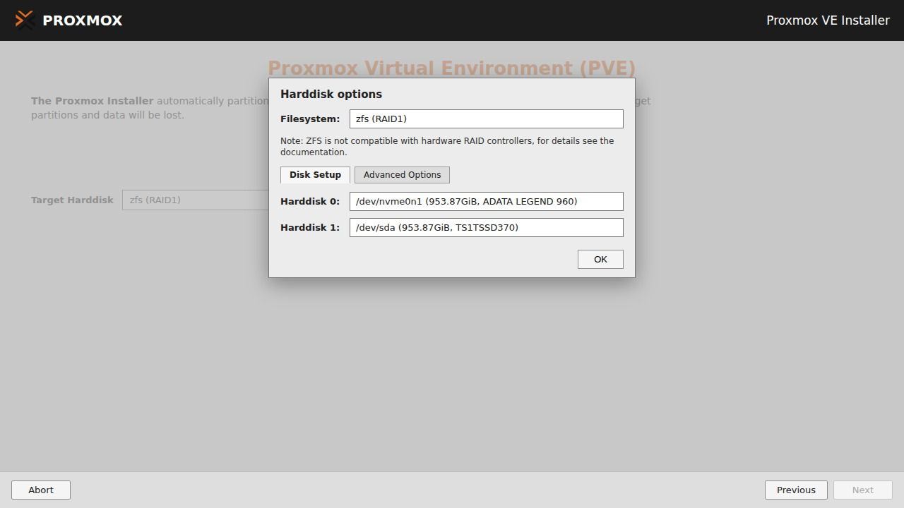
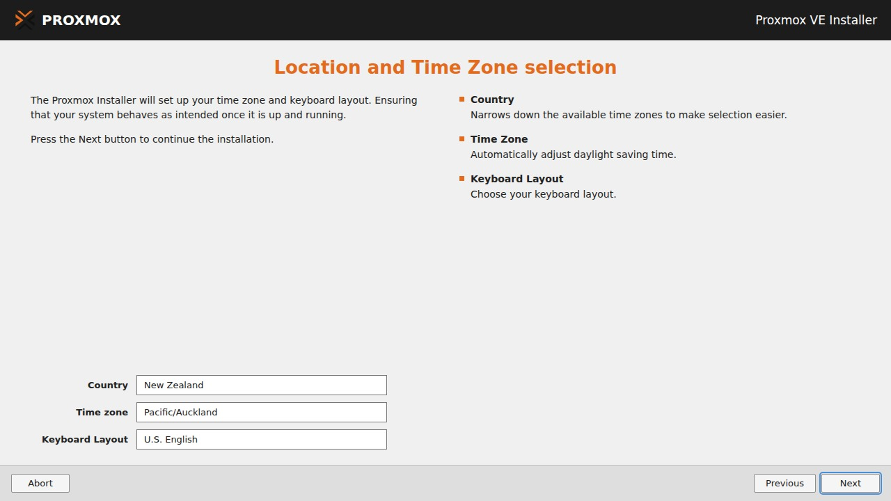
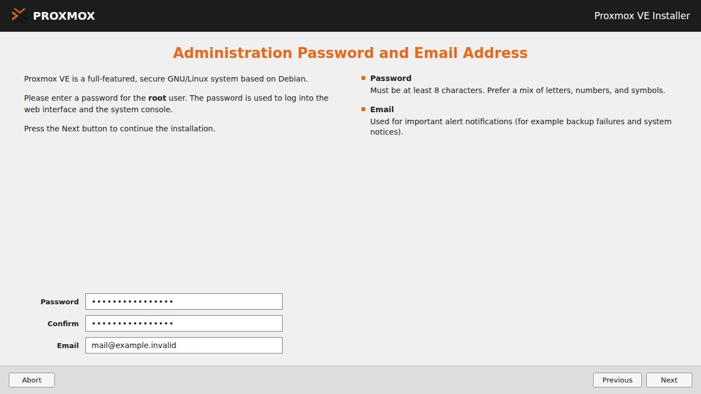
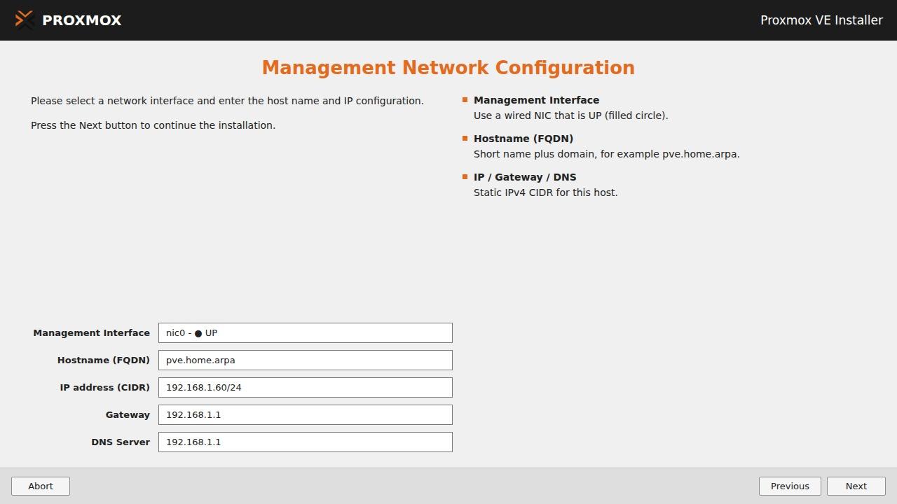
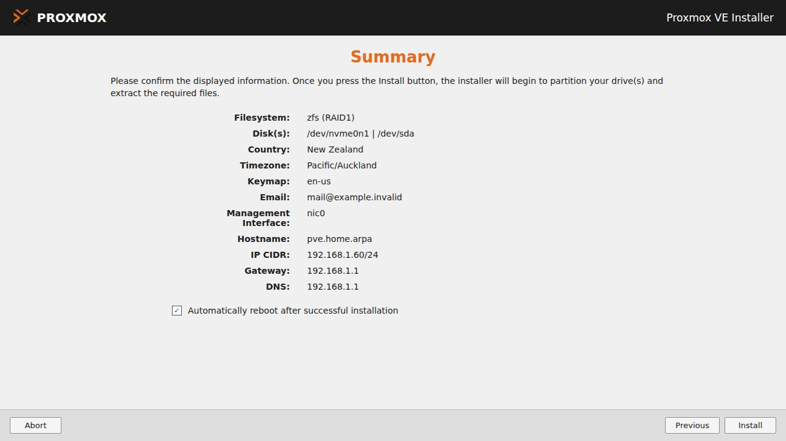

# Install

## 1. Boot the stick

Plug the stick into the **target** machine, with display, keyboard and
Ethernet. Power on and open the boot menu. The key varies by vendor (often
**F10**, **F12** or **Esc**).

Boot the USB in **UEFI** mode, then choose **Install Proxmox VE (Graphical)**.

!!! tip "Blank or garbled screen?"
    Reboot and pick **Terminal UI**. If that fails, press **e** on the entry,
    append `nomodeset`, and boot with **Ctrl+X**.

!!! tip "Keyboard only"
    **Alt** plus the underlined letter presses a button (**Alt+N** is Next).

## 2. EULA

## 3. Target Harddisk

!!! danger "Every selected disk is erased"
    Pick the machine's **internal** disk(s). Never the installer USB.

=== "Two disks: ZFS mirror"

    **Options** → filesystem **zfs (RAID1)** → pick both internal disks → set
    spare slots to **-- do not use --** → **OK** → **Next**.

    

    !!! warning "No hardware RAID under ZFS"
        Use pass-through (HBA / non-RAID) disks, or choose the ext4 tab.

=== "One disk: ext4"

    Keep the default **ext4** filesystem, select the single internal disk
    (not the USB), then **Next**.

## 4. Location

## 5. Password and email

The password is for `root` (console and web UI). Use 12+ characters. The email
receives system alerts, so replace the placeholder with an address you read.

## 6. Management network

| Field | Example |
| --- | --- |
| Interface | Wired NIC marked UP (filled circle) |
| Hostname (FQDN) | `pve.home.arpa` |
| IP (CIDR) | `192.168.1.60/24` |
| Gateway / DNS | `192.168.1.1` |

Use your own values. The hostname is awkward to change later. One IP family
only (IPv4 or IPv6) here.

## 7. Summary

Check every line, keep **Automatically reboot** ticked, then **Install**.
Remove the USB when the machine restarts.

If the install fails, press **Ctrl+Alt+F2** for logs.

## Next

[First boot](first-boot.md){ .md-button }
