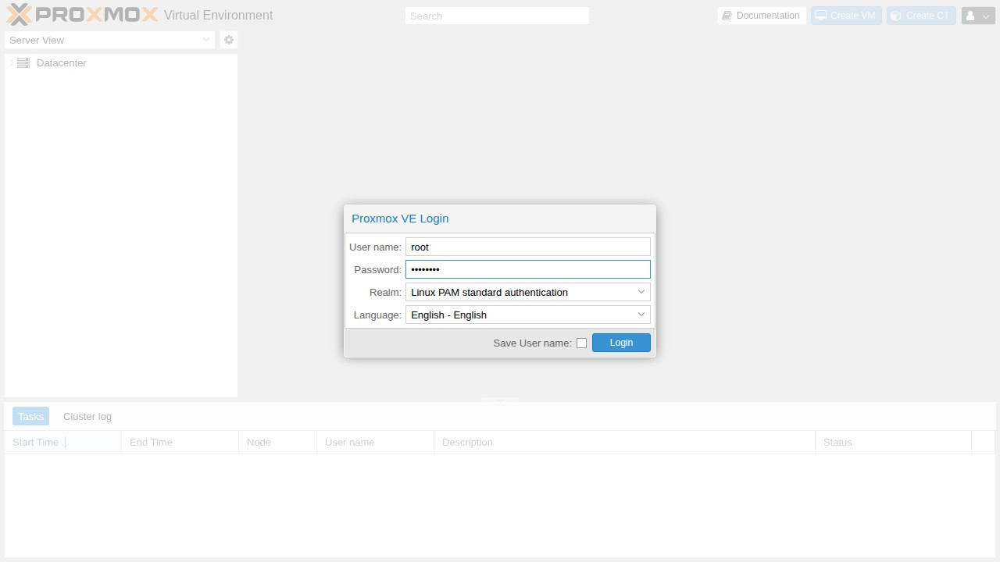
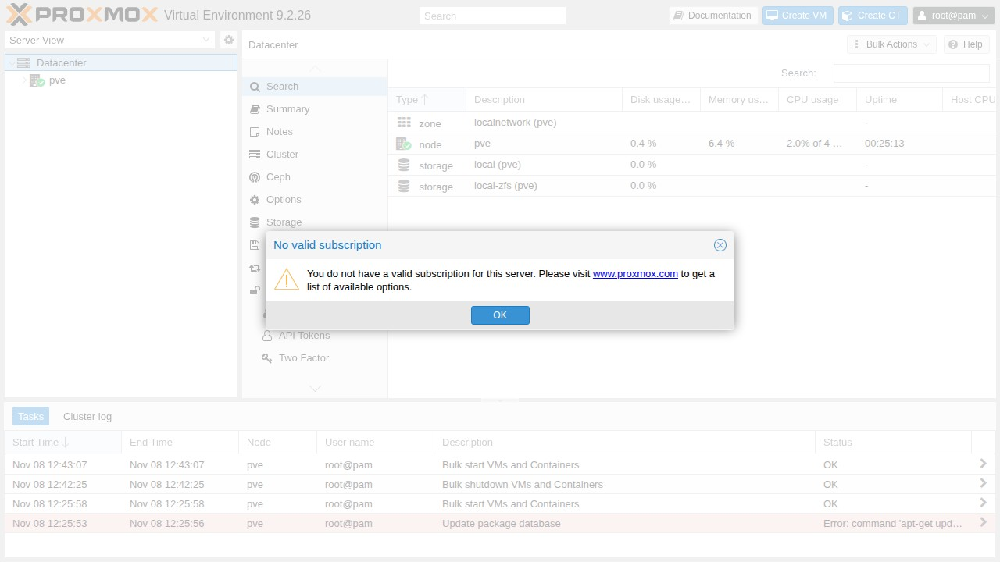
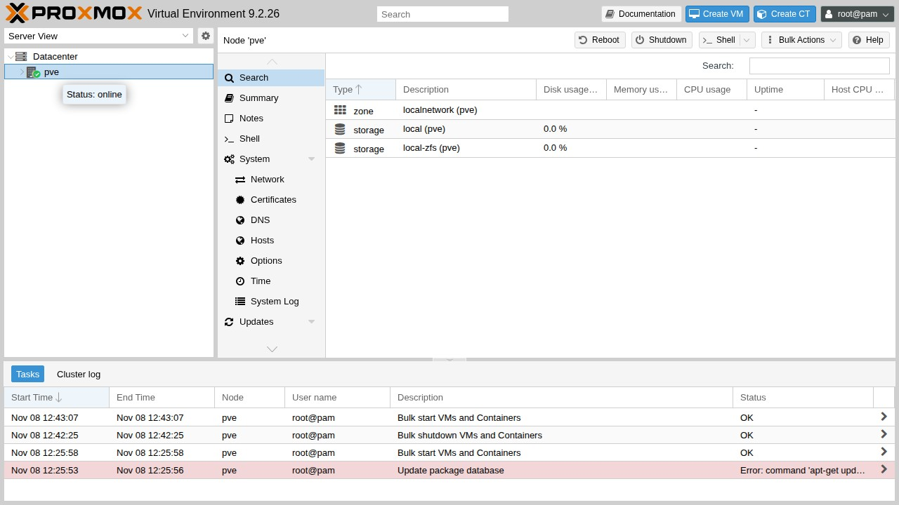
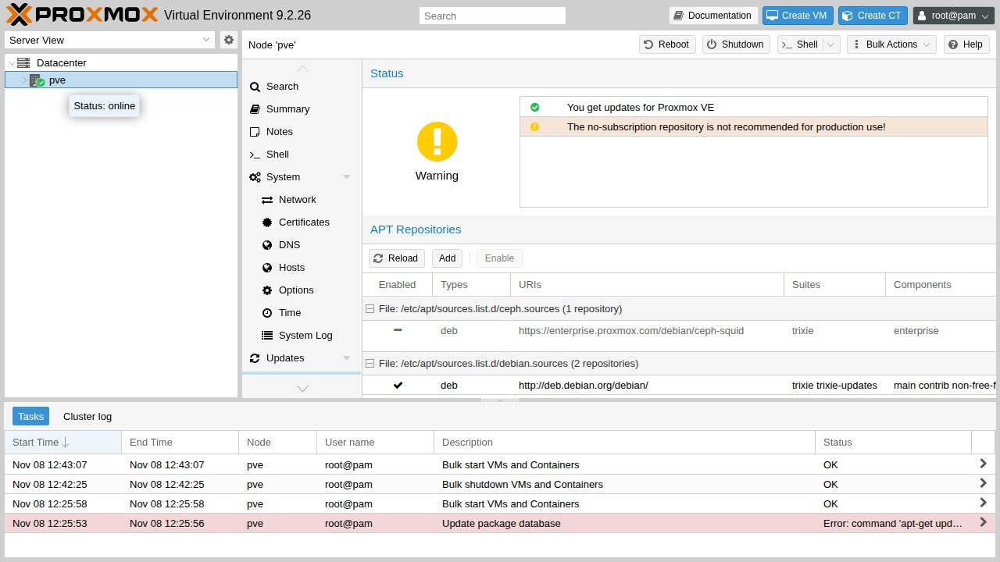

# Prove web UI

From the **workstation**. Use the IP from [First boot](first-boot.md).

<div class="run" markdown>

```bash
curl -k -sS -o /dev/null -w "%{http_code} %{server}\n" https://192.168.1.60:8006/
```

```text {.no-copy}
200 pve-api-daemon/3.0
```

</div>

Use a GET as above. `curl -I` can return 501 on this API.

## 1. Log in

Open `https://<ip>:8006/` and accept the self-signed certificate warning.
Username `root`, realm **Linux PAM standard authentication**.



## 2. Dismiss the subscription notice

It appears at every login, is cosmetic, and locks nothing.



## 3. Node online

Select **pve**. The tooltip reads **Status: online**, and `local` plus the
install storage are listed (`local-zfs` on the ZFS layout, `local-lvm` on
ext4).



## 4. Repositories

**Node → Updates → Repositories**. Enterprise entries are disabled and the
no-subscription repo is enabled.



The yellow **no-subscription is not recommended for production** warning is
expected on this path.

!!! note "Consuming labs"
    Keep `PVE_HOST` and credentials in that project's env file. Never commit
    passwords or API tokens.

## Done

You have an updated Proxmox VE host with a working web UI. Something wrong?
See [Troubleshooting](troubleshooting.md).
