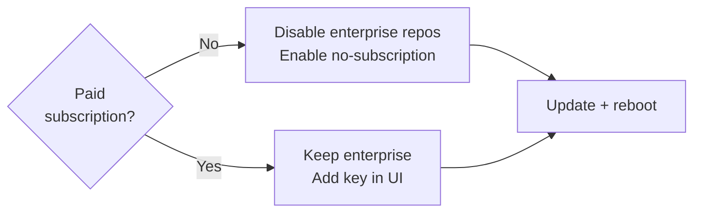

# Update host

Run as `root` on the console or over SSH. The ISO is a snapshot, so update
before you rely on the host.



Proxmox VE 9 runs on Debian 13 (Trixie) and keeps apt sources as deb822 files
in `/etc/apt/sources.list.d/`.

## 1. Repositories (no subscription)

Enterprise repos return **401** without a key. Skip this step if you have a
subscription.

!!! warning "`Enabled: false` stays inside the stanza"
    A blank line before it starts a new stanza and apt reports
    `Malformed stanza`.

<div class="run" markdown>

```bash
cat > /etc/apt/sources.list.d/pve-enterprise.sources <<'EOF'
Types: deb
URIs: https://enterprise.proxmox.com/debian/pve
Suites: trixie
Components: pve-enterprise
Signed-By: /usr/share/keyrings/proxmox-archive-keyring.gpg
Enabled: false
EOF
cat > /etc/apt/sources.list.d/ceph.sources <<'EOF'
Types: deb
URIs: https://enterprise.proxmox.com/debian/ceph-squid
Suites: trixie
Components: enterprise
Signed-By: /usr/share/keyrings/proxmox-archive-keyring.gpg
Enabled: false
EOF
cat > /etc/apt/sources.list.d/proxmox.sources <<'EOF'
Types: deb
URIs: http://download.proxmox.com/debian/pve
Suites: trixie
Components: pve-no-subscription
Signed-By: /usr/share/keyrings/proxmox-archive-keyring.gpg
EOF
ls /etc/apt/sources.list.d/
```

```text {.no-copy}
ceph.sources
debian.sources
proxmox.sources
pve-enterprise.sources
```

</div>

The same toggles exist in the UI under **Node → Updates → Repositories**.

## 2. Upgrade

<div class="run" markdown>

```bash
apt-get update
DEBIAN_FRONTEND=noninteractive apt-get -y dist-upgrade
pveversion
```

```text {.no-copy}
Hit:1 http://deb.debian.org/debian trixie InRelease
Get:2 http://download.proxmox.com/debian/pve trixie InRelease …
…
pve-manager/9.2.x/… (running kernel: …)
```

</div>

`apt-get update` must finish with no `401` or `Malformed stanza`.

## 3. Reboot if the kernel changed

If `pveversion` shows an older running kernel than the one just installed,
reboot.

<div class="run" markdown>

```bash
reboot
# once it is back:
pveversion
```

```text {.no-copy}
pve-manager/9.2.x/… (running kernel: <new version>-pve)
```

</div>

## Next

[Prove web UI](prove-web-ui.md){ .md-button }
